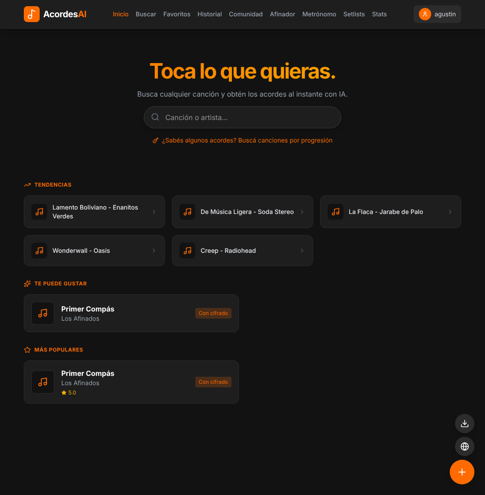
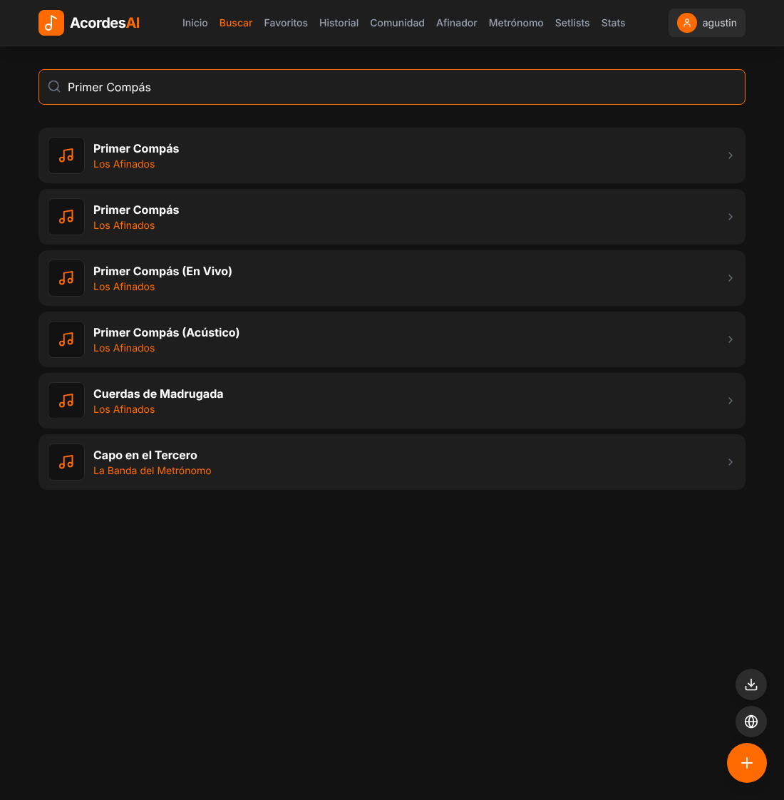
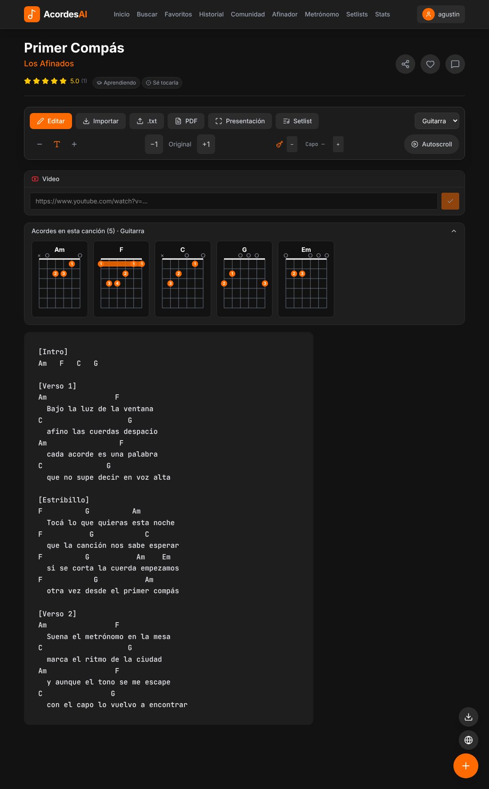
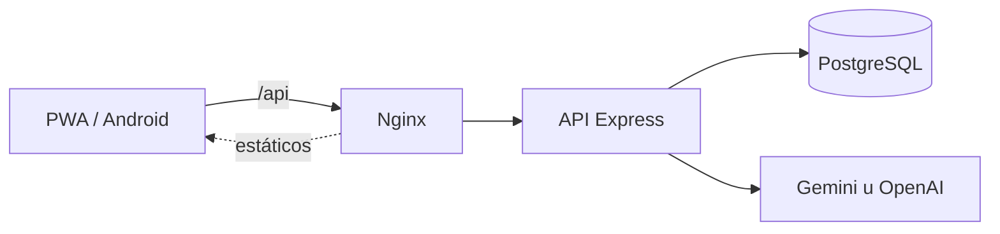

<div align="center">


# AcordesAI

**Cifrados, acordes y letras de cualquier canción, generados con IA.**

[](https://github.com/AgustinBouzonn/open-AcordesAI/actions/workflows/ci.yml)
[](LICENSE)


[**Abrir la app**](https://acordesai.bthings.com.ar) · [Sitio del proyecto](https://agustinbouzonn.github.io/open-AcordesAI/) · [Descargar para Android](https://github.com/AgustinBouzonn/open-AcordesAI/releases/latest)

</div>

---

AcordesAI es una Progressive Web App para músicos. En lugar de depender de una base de canciones ya transcritas, usa un modelo de lenguaje para generar el cifrado de **cualquier canción**, y lo combina con herramientas de práctica: transposición, autoscroll, afinador, metrónomo y estadísticas.

## Capturas

<table>
  <tr>
    <td align="center" width="33%"><br/><sub>Inicio</sub></td>
    <td align="center" width="33%"><br/><sub>Búsqueda</sub></td>
    <td align="center" width="33%"><br/><sub>Visor de cifrados</sub></td>
  </tr>
</table>

## Características

**Cifrados**
- Generación con IA de cifrado, letra y tonalidad para guitarra, ukelele y piano.
- Diagramas de acordes interactivos para los tres instrumentos.
- Importación desde Cifra Club, Ultimate Guitar y CifraSpot pegando la URL.
- Búsqueda por título, artista o progresión de acordes.

**Práctica**
- Transposición de tono y capo virtual, con normalización de bemoles.
- Autoscroll con velocidad ajustable y bucle de sección.
- Modo presentación a pantalla completa, con la pantalla siempre encendida.
- Afinador, metrónomo y estadísticas de práctica de los últimos 30 días.

**Biblioteca y comunidad**
- Favoritos e historial sincronizados entre dispositivos.
- Setlists privadas o compartidas por enlace, con vencimiento a los 30 días.
- Comentarios, valoraciones y recomendaciones.
- Exportación a PDF y TXT.

**Plataforma**
- PWA instalable que funciona sin conexión para lo que ya visitaste.
- App Android nativa con Capacitor.
- Inicio de sesión con email, Google o GitHub.

## Inicio rápido

Requisitos: Node.js 22 y PostgreSQL 15.

```bash
git clone https://github.com/AgustinBouzonn/open-AcordesAI.git
cd open-AcordesAI

npm install
npm --prefix backend install

cp .env.example backend/.env      # el backend lee su .env desde backend/
# editá backend/.env: DATABASE_URL apuntando a localhost, JWT_SECRET y una API key de IA
npm --prefix backend run migrate  # crea las tablas

npm --prefix backend run dev      # API en http://localhost:3001
npm run dev                       # app en http://localhost:3000
```

En desarrollo, Vite redirige `/api` al backend, así que no hace falta configurar CORS. Para probar desde el celular, abrí `http://<IP-de-tu-computadora>:3000` en la misma red Wi-Fi.

## Configuración

| Variable | Obligatoria | Descripción |
|---|:---:|---|
| `DATABASE_URL` | Sí | Cadena de conexión a PostgreSQL. |
| `JWT_SECRET` | Sí | Secreto para firmar sesiones, de al menos 32 caracteres. |
| `GEMINI_API_KEY` u `OPENAI_API_KEY` | Para IA | Sin clave, la app funciona solo con cifrados importados o creados a mano. |
| `FRONTEND_URL` | No | URL pública, usada en los callbacks de OAuth. |
| `GOOGLE_CLIENT_ID` y `GITHUB_CLIENT_ID` | No | Habilitan el login con cada proveedor, junto con su secreto. |

La lista completa, con los valores por defecto y la configuración del modelo, está en [docs/configuracion.md](docs/configuracion.md).

## Arquitectura



- **Frontend:** React 19, Vite, Tailwind CSS 4 y Workbox, en la raíz del repo.
- **Backend:** Express y TypeScript en `backend/`, con migraciones SQL en `backend/migrations/`.
- **IA:** toda la generación ocurre en el backend; las claves nunca llegan al navegador.

Detalle de carpetas, endpoints, seguridad y estrategia de caché: [docs/arquitectura.md](docs/arquitectura.md).

## Desarrollo

| Comando | Qué hace |
|---|---|
| `npm run dev` | Servidor de desarrollo del frontend. |
| `npm run typecheck` | Chequeo de tipos del frontend. |
| `npm run test:run` | Tests del frontend con Vitest. |
| `npm run test:backend` | Tests del backend con Vitest y Supertest. |
| `npm run test:e2e` | Tests end-to-end con Playwright. |
| `npm run build:all` | Build de producción del frontend y el backend. |

Antes de abrir un PR, corré la misma verificación que la CI:

```bash
npm run typecheck && npm run test:run && npm run test:backend
```

## Despliegue

- **Producción:** `docker compose` levanta PostgreSQL, la API y Nginx, pensado para correr detrás de un reverse proxy con TLS.
- **Deploy continuo:** cuando la CI pasa en `main`, un workflow ejecuta `scripts/deploy.sh` en el servidor. El script aplica las migraciones, reconstruye los contenedores y vuelve a la versión anterior si falla el health check.
- **Android:** cada release publica el APK y el AAB firmados. Para compilar a mano, seguí [docs/android-release.md](docs/android-release.md).
- **Sitio y estado:** GitHub Pages publica la landing y una página de estado que mide la disponibilidad cada 15 minutos.

Las migraciones deben ser idempotentes, porque el deploy las corre todas en cada release.

## Roadmap

Próximas versiones: reproductor de audio con control de tono y tempo, modo karaoke sincronizado, interfaz en inglés y portugués, renovación automática de sesiones y app para iOS. El historial de versiones está en [docs/roadmap.md](docs/roadmap.md).

## Contribuir

1. Hacé un fork y creá una rama desde `main`.
2. Si arreglás un bug, sumá un test que lo cubra.
3. Corré la verificación de la sección [Desarrollo](#desarrollo).
4. Abrí un Pull Request; se fusiona con la CI en verde.

## Licencia

[MIT](LICENSE) © Agustín Bouzon y colaboradores.

<div align="center">
<sub>Hecho por <a href="https://github.com/AgustinBouzonn">Agustín Bouzon</a> · <a href="https://linkedin.com/in/agustinbouzon">LinkedIn</a></sub>
</div>
