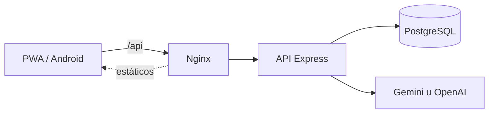

# Arquitectura

AcordesAI es una aplicación full stack: un frontend React servido como PWA y una API Express sobre PostgreSQL. Toda la integración con modelos de IA vive en el backend.



## Estructura del repositorio

```
open-AcordesAI/
├── App.tsx, index.tsx       # Raíz: HashRouter, rutas lazy, ErrorBoundary y providers
├── components/
│   ├── pages/               # Inicio, búsqueda, favoritos, historial, comunidad,
│   │                        # setlists, aprendizaje, estadísticas, búsqueda por acordes
│   ├── songViewer/          # Barra de transporte, modo presentación, tracker de práctica
│   ├── SongViewer.tsx       # Orquestador del visor de cifrados
│   ├── ChordDiagram.tsx     # Diagramas de guitarra, ukelele y piano
│   ├── Tuner.tsx, Metronome.tsx
│   └── ...                  # Modales: auth, crear, importar, compartir, setlists
├── services/
│   ├── apiClient.ts         # Cliente HTTP con reintentos y manejo de sesión vencida
│   ├── chordTransposer.ts   # Transposición, módulo puro con tests
│   ├── safeStorage.ts       # localStorage con fallback en memoria
│   └── ...                  # Afinador, metrónomo, wake lock
├── backend/
│   ├── src/
│   │   ├── app.ts, index.ts
│   │   ├── env.ts           # Validación de variables de entorno
│   │   ├── db.ts            # query() y withTransaction()
│   │   ├── middleware/      # Autenticación JWT y rate limiting
│   │   ├── routes/          # Un router por recurso
│   │   └── services/        # Proveedor de IA, sesiones y señales de producto
│   ├── migrations/          # SQL numerado e idempotente
│   └── test/                # Vitest y Supertest
├── android/                 # Proyecto nativo de Capacitor
├── landing/                 # Fuente de la landing de GitHub Pages
├── e2e/                     # Tests de Playwright
├── test/                    # Tests del frontend con jsdom
├── scripts/                 # Deploy, backups, importación masiva, landing y estado
├── docker-compose.yml       # PostgreSQL, API y Nginx
└── nginx.conf
```

## API

Todas las rutas cuelgan de `/api`.

| Ruta | Recurso |
|---|---|
| `/api/health` | Estado de la API y de la base de datos. |
| `/api/auth` | Registro, login con email y OAuth con Google o GitHub. |
| `/api/search` | Búsqueda de canciones. |
| `/api/songs` | Canciones y generación de cifrados. |
| `/api/import` | Importación desde una URL de Cifra Club, Ultimate Guitar o CifraSpot. |
| `/api/favorites`, `/api/history` | Biblioteca personal. |
| `/api/setlists` | Setlists privadas y compartidas. |
| `/api/comments`, `/api/ratings` | Comunidad. |
| `/api/recommendations` | Recomendaciones. |
| `/api/progress`, `/api/practice` | Progreso y sesiones de práctica. |
| `/api/signals` | Señales de producto y errores del cliente. |

## Seguridad

- **Transacciones atómicas** en operaciones sobre varias tablas, como importar una canción con su cifrado o reordenar setlists.
- **Tokens JWT** con códigos de error explícitos (`TOKEN_EXPIRED`, `TOKEN_INVALID`, `TOKEN_REVOKED`) y sesiones revocables. El frontend cierra la sesión automáticamente ante un 401.
- **Login sin filtración de cuentas:** si el email no existe, igual se ejecuta un bcrypt de relleno para que el tiempo de respuesta no lo delate.
- **OAuth** con verificación de `state` y aceptando solo emails verificados por el proveedor.
- **Prompts delimitados:** la entrada del usuario se sanitiza y se separa de las instrucciones del modelo.
- **Logs sanitizados:** nunca se registra el cuerpo completo de la respuesta del proveedor de IA ni la clave.
- **Enlaces de setlists** que vencen a los 30 días.
- **Rate limiting** por usuario o IP en autenticación, importación, comentarios y generación de cifrados.

## Caché y modo sin conexión

El service worker usa Workbox con dos estrategias:

| Recurso | Estrategia |
|---|---|
| Listados de canciones (`/api/songs`, sin los cifrados) | `StaleWhileRevalidate`: responde con la caché y actualiza en segundo plano. |
| Favoritos, historial y setlists | `NetworkFirst` con 4 segundos de timeout, y caché como respaldo. |

El manifest declara un `share_target`, así que en Android se puede compartir un enlace hacia AcordesAI desde otras apps.

El build separa el código en chunks de React, PDF y audio para que la carga inicial sea liviana.
