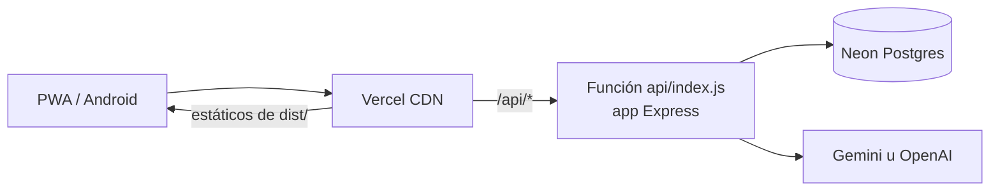

# Deploy en Vercel + Neon (gratis)

Producción corre en dos servicios con plan gratuito:

- **Vercel (Hobby):** sirve el frontend y una función serverless con la API Express (`api/index.js`).
- **Neon (Free):** PostgreSQL administrado.

La configuración está en el repo (`vercel.json`, `scripts/vercel-build.sh`), así que en los paneles solo hay que crear las cuentas y cargar las variables.

## Cómo funciona



- Cada push a `main` dispara un deploy de producción. Las otras ramas no se construyen (`ignoreCommand` en `vercel.json`), porque un preview usaría la misma base que producción.
- El build (`scripts/vercel-build.sh`) compila el frontend y después corre **todas** las migraciones contra Neon (son idempotentes). Si una migración falla, el deploy falla y queda la versión anterior.
- La función y la base están en São Paulo (`gru1` y `aws-sa-east-1`), la región más cercana a Argentina.
- El CI corre `vercel build` en cada PR (job `vercel-build`): si `vercel.json` o el empaquetado de la función se rompen, falla ahí y no en producción.

## Puesta en marcha (una sola vez)

### 1. Crear el proyecto en Vercel

1. Entrá a <https://vercel.com/signup> con tu cuenta de GitHub. Elegí el plan **Hobby**.
2. **Add New… → Project** e importá `AgustinBouzonn/open-AcordesAI`.
3. No cambies nada en *Build and Output Settings*: todo sale de `vercel.json`.
4. En **Environment Variables**, cargá estas variables, todas solo en *Production*:

   | Variable | Valor |
   |---|---|
   | `JWT_SECRET` | La misma del `.env` del VPS, así nadie tiene que volver a iniciar sesión. Si no la tenés, generá una con `openssl rand -base64 48`. |
   | `GEMINI_API_KEY` u `OPENAI_API_KEY` | Tu clave de IA. |
   | `FRONTEND_URL` | `https://acordesai.bthings.com.ar` |
   | `GOOGLE_CLIENT_ID`, `GOOGLE_CLIENT_SECRET`, `GITHUB_CLIENT_ID`, `GITHUB_CLIENT_SECRET` | Solo si usás login social. Copialas del `.env` del VPS. |

5. Tocá **Deploy**. El primer deploy **falla** en el paso de migraciones porque todavía no hay base: es lo esperado.

### 2. Crear la base en Neon desde Vercel

1. En el proyecto de Vercel: **Storage → Create Database → Neon**. Si te lo pide, creá la cuenta de Neon desde ahí.
2. Plan **Free**, región **South America (São Paulo)**.
3. Al conectarla al proyecto, marcá solo el entorno **Production**. Vercel agrega varias variables. Las que se usan son `DATABASE_URL` (la conexión con pooler, para la app) y `DATABASE_URL_UNPOOLED` (la directa, para las migraciones).
4. **Deployments →** el último deploy **→ ⋯ → Redeploy**.
5. Abrí `https://<tu-proyecto>.vercel.app/api/health`. Tiene que responder `{"status":"ok","db":"ok",...}`.

### 3. (Opcional) Traer los datos del VPS

Este paso hace falta solo si la base del VPS tiene usuarios o canciones que quieras conservar. Corré esto **en el VPS**, en la carpeta del repo, con la cadena **directa** de Neon: es `DATABASE_URL_UNPOOLED`, la que no tiene `-pooler` en el host, y la ves en Vercel → Settings → Environment Variables.

```bash
NEON_URL='postgresql://...neon.tech/neondb?sslmode=require'
docker compose exec -T postgres sh -c \
  'pg_dump -U acordesai --clean --if-exists --no-owner --no-acl acordesai | psql -v ON_ERROR_STOP=1 "$0"' "$NEON_URL"
```

- `--clean --if-exists` reemplaza lo que haya en Neon, así que no importa que el paso 2 ya haya creado las tablas.
- Después del restore, hacé **Redeploy** una vez más: las migraciones completan lo que le falte al esquema viejo del VPS, como las columnas de los últimos PRs.
- Neon Free tiene 0,5 GB de almacenamiento. Para ver cuánto ocupa la base actual: `docker compose exec postgres psql -U acordesai -c "select pg_size_pretty(pg_database_size('acordesai'))"`.

### 4. Apuntar el dominio

1. En Vercel: **Settings → Domains → Add**, con el dominio `acordesai.bthings.com.ar`.
2. En Cloudflare (DNS de `bthings.com.ar`), reemplazá el registro `A acordesai → 195.200.1.74` por:
   - Tipo `CNAME`, nombre `acordesai`, destino `cname.vercel-dns.com`.
   - **Proxy status: DNS only** (nube gris). Con la nube naranja, Vercel no puede emitir el certificado y el backend ve las IPs de Cloudflare en vez de las de los usuarios, así que el rate limit sería uno solo para todos.
3. Cuando Vercel marque el dominio como *Valid*, la app de Android y los links compartidos siguen funcionando sin cambios, porque el dominio es el mismo.

Si usás login con Google o GitHub, la URL de callback no cambia: `https://acordesai.bthings.com.ar/api/auth/oauth/<google|github>/callback`.

Recién con el dominio andando en Vercel se puede apagar el VPS. El monitor de estado (`status.yml`) mide el mismo dominio, así que no hay que tocar nada más.

## Límites del plan gratis

- **Vercel Hobby** es para uso personal y no comercial. Si la app pasa a generar ingresos, hay que pasar a Pro.
- Cada request a la API puede durar hasta 60 s (`maxDuration` en `vercel.json`). Alcanza: la IA corta a los 20 s y el import a los 15 s.
- **Neon Free** suspende la base después de 5 minutos sin uso. El primer request después de eso tarda alrededor de un segundo más. Por eso el health check espera hasta 5 s a la base y el pool ignora las conexiones que Neon corta (`backend/src/db.ts`).
- Los rate limits viven en memoria de cada instancia de la función, así que son aproximados: Vercel puede repartir los requests entre varias instancias.
- Backups: Neon permite restaurar la base a un punto de las últimas horas (*Restore* en el panel de Neon). Para tener un dump propio, corré `pg_dump "$DATABASE_URL_UNPOOLED" > backup.sql` desde cualquier máquina con `psql`.

## Self-hosting

`docker-compose.yml` sigue funcionando igual para correr todo en un servidor propio: Postgres, API y Nginx. El deploy automático por SSH al VPS se eliminó, ahora producción es Vercel.
